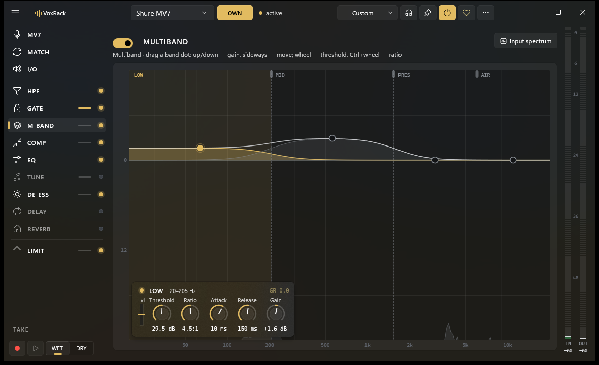
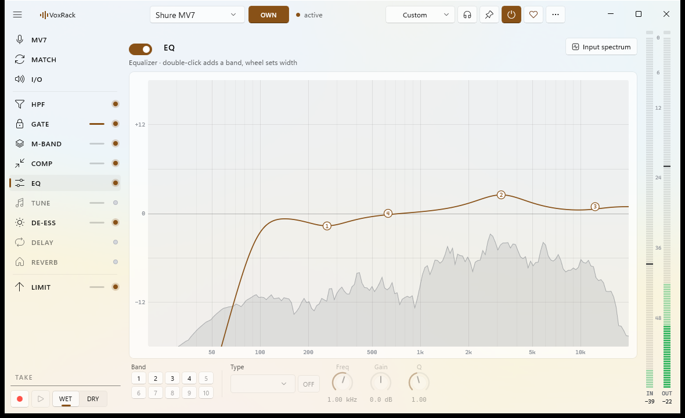
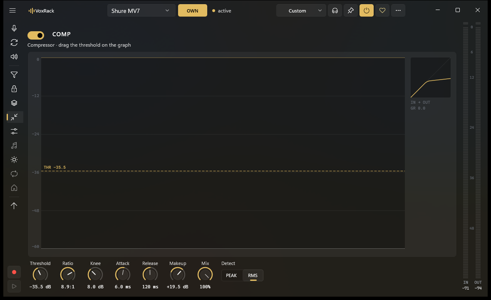

<p align="center">
  
</p>

<h1 align="center">VoxRack</h1>

<p align="center">
  <b>Студийная обработка голоса, встроенная прямо в микрофон Windows.</b><br>
  Эквалайзер · многополосный компрессор · компрессор · гейт · де-эссер · автотюн · делей · реверб · лимитер —<br>
  для OBS, Discord, Zoom, Telegram и любых других программ. Без виртуальных кабелей.
</p>

<p align="center">
  <a href="https://github.com/vpainer/voxrack/releases/latest"></a>
  <a href="https://github.com/vpainer/voxrack/releases"></a>
  
  <a href="LICENSE"></a>
</p>

<p align="center">
  <a href="https://github.com/vpainer/voxrack/releases/latest"><b>Скачать</b></a> ·
  <a href="#возможности">Возможности</a> ·
  <a href="#как-это-устроено">Как устроено</a> ·
  <a href="#сборка">Сборка</a> ·
  <a href="#поддержать">Поддержать</a> ·
  <a href="README.md">English</a>
</p>

<p align="center">
  
</p>

## Зачем

Фирменные программы микрофонов обычно дают робкий компрессор и эквалайзер на три полосы. Гнать голос через DAW
или «виртуальные кабели» можно, но это задержка, лишние устройства и вещи, которые ломаются после обновлений.

VoxRack ставит звуковой эффект реального времени (**APO** Windows) на сам микрофон. Windows выполняет его в своём
аудиодвижке, поэтому **любая программа** — OBS, Discord, Zoom, Teams, Telegram, браузер — просто открывает
привычный микрофон и получает уже обработанный звук. Драйвер остаётся родным, ничего никуда не перенаправляется.

Окно нужно только для настройки: закрой его — обработка продолжит работать, переживёт перезагрузку и займёт около
1,5 % одного ядра процессора со всем включённым.

## Возможности

| | |
|---|---|
| **Цепочку можно переставлять** | Срез низа, гейт, автотюн, эквалайзер на 10 полос, многополосный на 4, компрессор, де-эссер, делей, реверб — в любом порядке перетаскиванием. Вход/выход первые, лимитер последний. |
| **Многополосный как у профи** | Полосы прямо на живом спектре: точку полосы тянешь вверх-вниз — громкость, вбок — сдвиг полосы, колесо — порог, Ctrl+колесо — степень. Ручки выбранной полосы — в панели под ней. |
| **Видно, что происходит** | Живой спектр до и после, история подавления у гейта, компрессора и лимитера, характеристика компрессора с текущей точкой, график высоты голоса в автотюне, вид эха и хвоста реверба. |
| **Автотюн** | Высота — YIN, сдвиг — PSOLA с сохранением формант: тональность, лад, скорость (0 — «робот»), сила, транспонирование. |
| **Свои настройки у каждого микрофона** | Несколько микрофонов с VoxRack? У каждого свои настройки (OWN) или общие на всех (SHARED). |
| **MATCH** | Запиши одну фразу в два микрофона — VoxRack подберёт эквалайзер, громкость, плотность и гейт, чтобы цель звучала как эталон. |
| **TAKE** | Запиши фразу и крути ручки, пока она играет по кругу через цепочку; сравнение с сухим дублем. |
| **MON** | Слушать обработанный голос в наушниках (≈ 40 мс). |
| **Пресеты** | Подкаст, Радио, Стрим, Созвоны — или свои. |
| **Для Shure MV7** | Режимы подсветки, блокировка касаний и «мигнуть» у оригинального Shure MV7 по его USB HID-каналу. |
| **Родное приложение Windows 11** | WinUI 3 с Mica, светлая и тёмная тема и цвет акцента — как в Windows, английский и русский, сворачиваемая панель. |

<p align="center">
  
  
</p>

## Установка

1. Скачай **`VoxRack-x.y.z-win-x64.zip`** со страницы [последнего релиза](https://github.com/vpainer/voxrack/releases/latest).
2. Распакуй куда удобно (например, `%LOCALAPPDATA%\Programs\VoxRack`) и запусти **`VoxRack.exe`**.
   Всё нужное внутри папки — ставить .NET или Windows App SDK не надо.
3. Выбери микрофон в заголовке окна и нажми **Подключить**. Windows один раз спросит права администратора,
   аудиослужбы перезапустятся — звук пропадёт на пару секунд.

Готово: программы пользуются тем же микрофоном, но звук уже обработан.

> **SmartScreen** может предупредить о неизвестном издателе — у программы пока нет цифровой подписи.
> Нажми *Подробнее → Выполнить в любом случае* или собери сам из исходников.

**Нужно:** Windows 10 (2004+) или Windows 11, x64. Mica — только в Windows 11.

**Удаление:** `⋯ → Снять обработку с микрофона`, потом удали папку. Настройки лежат в `%AppData%\Golos`,
сам эффект — в `C:\Program Files\Golos` (Golos — рабочее имя проекта).

**Полезно знать**

* Программы, которые открывают микрофон в «сыром» (*raw*) или монопольном режиме (некоторые DAW), обходят эффекты
  Windows — так устроена система. Программы связи (Discord, Zoom, Telegram, Teams) и OBS обрабатываются.
* Гнездо наушников на USB-микрофоне — аппаратный монитор, в нём звук без обработки. Себя обработанного — кнопкой **MON**.
* Если у микрофона есть своя обработка (например, в Shure MOTIV), выключи её, чтобы звук не обрабатывался дважды.
* VoxRack проверяет новую версию на GitHub не чаще двух раз в день; больше ничего с компьютера не уходит.

## Как это устроено

```
микрофон → USB-драйвер → audiodg.exe ─[ GolosAPO.dll ]─→ OBS / Discord / Zoom / …
                                         ↑ параметры    ↓ уровни, спектр
                            C:\ProgramData\Golos\state.bin  (общая память)
                                         ↑↓
                                    VoxRack.exe  (WinUI 3)
```

* **`apo/`** — сам эффект на C++17 без зависимостей, собирается MinGW-w64: биквады RBJ с плавной сменой
  коэффициентов, кроссоверы Линквица–Райли с фазовой компенсацией, компрессор с мягким коленом, лимитер
  с заглядыванием, автотюн YIN + PSOLA, Freeverb. Windows грузит его в `audiodg.exe` как SFX APO выбранного микрофона.
* **`state.bin`** — файл в памяти, который открывают обе стороны: окно пишет параметры (seqlock), APO подхватывает
  их на следующем блоке 10 мс и пишет обратно уровни, подавление и кольца сигнала до и после обработки.
* **`core/`** — общая память, WASAPI (мониторинг и плеер дубля), установка, подгонка эквалайзера, HID MV7.
* **`app/`** — окно на WinUI 3: графики на Win2D, векторные ручки, остальное — штатные контролы WinUI.

Подробнее: [docs/ARCHITECTURE.md](docs/ARCHITECTURE.md).

## Сборка

Нужны Windows, [.NET 9 SDK](https://dotnet.microsoft.com/download) и MinGW-w64 (UCRT64) из
[MSYS2](https://www.msys2.org/): `pacman -S mingw-w64-ucrt-x86_64-gcc`. Visual Studio не нужна.

```sh
sh apo/build.sh test          # GolosAPO.dll, GolosDsp.dll, golosctl.exe → build/ + проверки DSP и COM
dotnet publish app -c Release -r win-x64 --self-contained false -p:PublishDir=dist/
```

Если `g++` нет в `PATH`, укажи путь: `MINGW_BIN=/c/msys64/ucrt64/bin sh apo/build.sh`.
Каждый пуш собирается в GitHub Actions; тег `v*` выпускает релиз с готовым архивом.

## Участие

Сообщения об ошибках, идеи и пулл-реквесты — welcome, см. [CONTRIBUTING.md](CONTRIBUTING.md).
Перед большими изменениями лучше открыть issue и договориться о подходе.

## Поддержать

VoxRack бесплатный и открытый, его делает один независимый разработчик в свободное время. Если голос стал звучать лучше:

* ⭐ **Поставь звезду репозиторию** — так проект легче найти.
* 🗣 **Расскажи друзьям** или покажи на стриме.
* 🐞 **Пиши об ошибках и идеях** в [Issues](https://github.com/vpainer/voxrack/issues).
* 💛 **Донат** — ссылки скоро появятся.

## Лицензия

[GPL-3.0-or-later](LICENSE) © 2026 Victor Painer. VoxRack можно использовать, изучать, распространять и менять;
изменённые версии при распространении должны оставаться открытыми под той же лицензией.

*Shure и MV7 — товарные знаки Shure Incorporated. VoxRack — независимый проект, не связан с Shure и не одобрен ею.*
